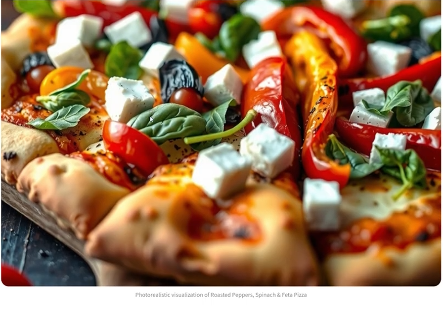

# 🍽️ Fridge2Feast

**From fridge to feast: snap a photo of your fridge and get a personalized recipe with nutrition info and a picture of the finished dish.**

Fridge2Feast is an AI-powered web app that detects the ingredients in a photo of your fridge, then generates a recipe tailored to your cuisine style and health goals. It helps people decide what to cook quickly while reducing food waste.

**[▶ Watch the 4-minute demo](https://youtu.be/c8Eyi7PfzDc)**

> **Note:** The live app is offline because the API keys it used have expired. The demo video shows the full app working. To run it yourself, add your own keys (see Setup).


<!-- Add 1-2 screenshots to a /docs folder and update the path -->

---

## 💡 Problem

Many people struggle to decide what to cook with what's already in their fridge. This leads to wasted food, unnecessary grocery trips, and time spent searching for recipes online.

---

## 🚀 Features

- **Fridge photo recognition:** upload one photo and Gemini Vision detects the ingredients, so there's no typing
- **Personalized recipes:** choose a cuisine style and your health goals
- **Two recipe modes:** AI-generated recipes or pre-made recipes
- **Nutritional analysis** and **cooking times** for every recipe
- **Step-by-step cooking instructions**
- **AI-generated image** of the finished dish
- **Fast:** a full recipe in about 25 seconds

---

## 🧠 How It Works

1. The user uploads a photo of their fridge.
2. **Gemini 2.5 Flash Vision** detects the ingredients in the photo.
3. The user selects a cuisine style, health goals, and AI-generated or pre-made recipes.
4. For pre-made recipes, the app queries the **Spoonacular API** for matches.
5. **Gemini** produces the final recipe with step-by-step instructions, nutritional analysis, and cooking time.
6. The app generates an image of what the finished dish could look like.

---

## 🛠 Tech Stack

- **Frontend:** Streamlit
- **Backend:** Python
- **APIs:** Google Gemini API (vision, recipes, images), Spoonacular API (recipe data)
- **Libraries:** streamlit, google-generativeai, pillow, requests

---

## ⚙️ Setup

1. Clone the repository
   ```bash
   git clone https://github.com/[YOUR-USERNAME]/[REPO-NAME].git
   cd [REPO-NAME]
   ```

2. Install dependencies
   ```bash
   pip install -r requirements.txt
   ```

3. Add your own API keys in `.streamlit/secrets.toml` (see `.streamlit/secrets.toml.example`)
   ```toml
   GEMINI_API_KEY = "your_api_key_here"
   SPOONACULAR_API_KEY = "your_api_key_here"
   ```

4. Run the app
   ```bash
   streamlit run app.py
   ```

---

## 📂 Project Structure

```
Fridge2Feast
├── app.py
├── requirements.txt
├── .streamlit/
│   └── secrets.toml.example
└── README.md
```

---

## 🔮 Future Improvements

- Support more dietary restrictions (vegan, halal, gluten-free, allergies)
- Let users save favorite recipes
- Improve the UI and mobile responsiveness

---

## 👨‍💻 Team

- Wasi Ullah
- Devarya Roy
- Armin Farhad
- Anushivan Pratheepan
